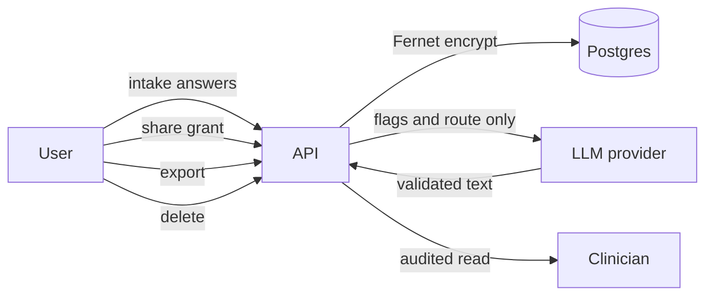

# Privacy and governance

## Data flow

No names, handles or contact details ever reach the LLM. Logs carry
request ids, routes and durations only, never answers or decrypted
values.

## What is stored where

- `users`: pseudonymous handle, role, language, encrypted contact,
  password hash for staff only, soft-delete marker.
- `consents` (append-only): every grant and revocation with policy
  version. Kept through deletion as the legal record.
- `intake_answers`: one encrypted JSON blob per user plus schema version.
- `assessments`, `explanations`, `workflow_traces`: screening outputs
  and the timed pipeline trace.
- `referrals`, `referral_events` (append-only), `reminders`,
  `clinician_reviews`: lifecycle rows; outcome and review notes are
  encrypted; reminders are simulated records, never real messages.
- `shares`: grants with scope, expiry and revocation.
- `audit_log` (append-only): actor, action, object and non-sensitive
  detail. Deletion nulls actor ids instead of removing rows; the
  Postgres trigger permits exactly that update shape.
- `providers`: seeded mock directory.

## Encryption, retention and deletion

Field-level Fernet encryption covers intake answers, contacts and every
free-text clinical note, with the key from `FIELD_ENCRYPTION_KEY` (see
`.env.example`; rotation is documented as future work, not implemented).
`DELETE /me` removes intake, contact, assessments, explanations,
referrals with events and reminders, shares and traces, anonymises audit
rows and marks the user deleted; `GET /export` returns everything held.
There is no automatic retention expiry in the prototype.

## Access control

Every endpoint declares its role and consent needs through dependencies
(default deny). Users see only their own data; navigators handle
referral logistics plus route context; clinicians sign off and read
shared records only, with every read audited and visible to the owner.
Shares expire hourly-bounded (max 30 days) and revoke immediately.

## Draft DPIA outline

1. Describe the processing: consented screening, triage, referral and
   follow-up for men's reproductive health.
2. Assess necessity: data minimised to the intake schema; no accounts,
   no tracking, no analytics without explicit consent.
3. Identify risks: re-identification from small datasets, model
   leakage, over-retention, cross-user access bugs.
4. Mitigations in place: pseudonymity, encryption, append-only
   ledgers, validated model outputs with template fallback, share
   scoping with audit, one-click export and deletion.
5. Residual risks and review: unvalidated draft rules, single-process
   rate limiting, no retention expiry; review before any pilot.

## What this prototype does and does not claim

It implements the principles above on synthetic data only. It is not
clinically validated and claims no compliance with any health-data
regime. Roadmap only, not implemented: the DoH Responsible AI Standard,
ADHICS, DoH digital-product licensing, UAE health-data residency
requirements, and Malaffi/Sahhatna integration.
