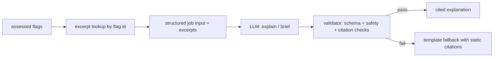

# RAG grounding design (draft for clinician review)

Status: **machinery implemented; corpus is draft.** The retrieval loop,
citation schema, validator checks, template/mock citations and benchmark
metrics are built and tested. The seed corpus reuses existing draft
snippet texts (no new clinical content, `verbatim: false`,
`requires_clinical_validation: true` on every entry) and must be
replaced with advisor-approved verbatim quotes before any pilot. The
clinical advisor reviews the corpus and the safety argument.

## 1. Goal and non-goals

Goal: let explanations and clinician briefs quote short, approved
guideline excerpts so users and clinicians can see *where* a statement
comes from — without changing what the system decides.

Non-goals (hard boundaries):

1. Retrieval never influences flags, routes or triage. Rules decide;
   retrieval only annotates explanations.
2. No new clinical claims enter the product through retrieval. Every
   excerpt is approved verbatim by the clinical advisor first.
3. No live web or open-corpus retrieval. The corpus is a small,
   versioned, fully reviewed file set.

## 2. Current state

Explanations come from one of three sources: the LLM (structured,
validator-gated), deterministic templates, or static safety text for the
urgent route (`app/llm/`, `app/services/explain.py`). Flag snippets live
in `app/content/snippets.*.json`. Nothing is cited to an external
document today.

## 3. Proposed design

### 3.1 Excerpt corpus

A versioned file set, `app/content/excerpts.en/ar.json`, holding short
excerpts for citation. The target state is verbatim quotes (1–3
sentences each) from the verified references in
`docs/research-grounding.md`, each approved verbatim by the clinical
advisor. The current seed instead reuses the existing draft snippet
texts (one excerpt per flag: `EXC_<flag id>`), generated reproducibly
by `scripts/build_excerpt_seed.py`, so the seed invents no clinical
text. Each excerpt carries:

```json
{
  "id": "EXC_LS_TTC_STANDARD",
  "text": "<draft snippet text, en or ar>",
  "applies_to_flags": ["LS_TTC_STANDARD"],
  "source_hint": "<believed provenance, unvalidated>",
  "verbatim": false,
  "requires_clinical_validation": true
}
```

Arabic text ships as draft with `needs_native_review: true` until a
native reviewer clears it, following the existing content convention.

### 3.2 Retrieval (deterministic first)

At explain time, the service looks up excerpts by flag id through the
`applies_to_flags` map — a deterministic lookup, not a similarity
search. Rationale: the corpus is tiny (dozens of excerpts), the mapping
is reviewable line by line, and retrieval becomes a pure function the
test suite can pin exactly. Semantic search (e.g. Azure AI Search over
a larger excerpt set) is a later scale path, explicitly out of scope
for this design.

### 3.3 Generation and citation

Retrieved excerpts join the existing structured job input (flag ids,
states, snippet texts). The output schema gains one field per flag:

```json
{"flag_id": "...", "explanation": "...", "sources": ["EXC_TTC_12MO"]}
```

The validator gains one check alongside the existing ones: every cited
id must have been provided in the input (no invented citations).
Coverage (provided excerpts cited per present flag) is measured in
evaluation (§5), not enforced inline, and groundedness beyond
citation-existence (does the sentence faithfully reflect the excerpt?)
is advisor spot-check — the validator stays a deterministic checker.

Fallbacks are unchanged: rejected or timed-out outputs fall back to
templates, and templates cite excerpt ids statically.

### 3.4 Data flow



The urgent route is untouched: static safety text, no LLM call, no
retrieval.

## 4. Risks and mitigations

| Risk | Mitigation |
|---|---|
| Wrong excerpt attached to a flag | Deterministic map reviewed per line; test pins every mapping |
| Excerpt text drifts from the source | Verbatim quotes with source doc + section; versioned corpus |
| Arabic mistranslation | `needs_native_review` until cleared, as today |
| Users over-trust citations | Screening disclaimer stays; citations are pointers, not proof |
| Corpus staleness as guidelines update | Corpus version + review date; re-review on new editions |
| Excerpt used to smuggle new claims | Advisor approves each excerpt verbatim; validator blocks uncited ids |

## 5. Evaluation plan

Extend the benchmark report with: citation precision (cited ids ⊆
provided ids, target 100%), citation coverage per present flag,
validator rejection rate with citations enabled, and English–Arabic
citation parity. Advisor spot-checks a sample of generated explanations
against the quoted excerpts before any pilot.

## 6. Open questions for the clinical advisor

1. Is quoting these four documents in user-facing explanations
   appropriate, and are there sections that must never be quoted?
2. Is the proposed excerpt granularity (1–3 sentences) right, or should
   excerpts be shorter/longer?
3. Who approves each excerpt, and what review cadence applies when
   guidelines are updated?
4. Are draft Arabic translations of quotes acceptable pending native
   review, or should Arabic cite the English excerpt until cleared?
5. Should templates (the fallback path) carry citations at all, or stay
   citation-free by design?

## 7. Implementation (done; corpus still draft)

- `app/content/excerpts.en/ar.json` + fail-fast loader
  (`app/services/content.py`), startup cross-check in `_warm_caches`.
- Pure retrieval in `app/llm/retrieval.py` with truth-table tests.
- `sources` on `ExplainedFlag`/`BriefFlag`/`AssessFlag`, populated by
  templates, mock and pipeline; validator rejects invented citations.
- Benchmark citation precision, present-flag coverage and cited-set
  parity in `benchmark/run_benchmark.py` + report.
- Tests: loader failures, retrieval mapping, invented-citation
  rejection, template/mock/service sources, contract `sources` key.
